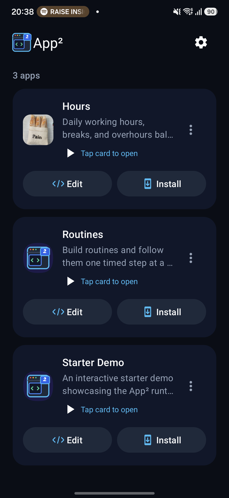
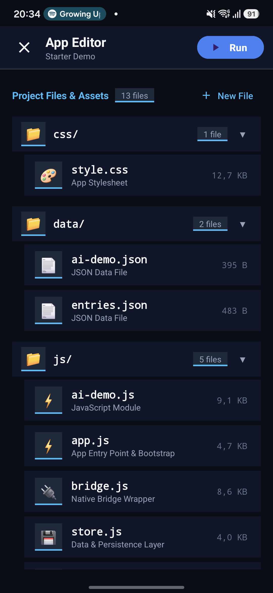

# App² — Import, create, and run your own apps

**Import an app from a ZIP or a public GitHub repository and run it on your Android phone.** App² keeps your apps in one library, lets you edit their files, and can add them to your home screen. You can also create your own apps from the included starter.

<table>
  <tr>
    <td align="center"><br><strong>Your app library</strong></td>
    <td align="center"><br><strong>Edit files on your phone</strong></td>
  </tr>
</table>

## What you can do

- **Import apps** from ZIP files or public GitHub repositories and folders. Add apps made by others or bring in your own HTML, CSS, and JavaScript projects.
- **Create your own apps** (called *subapps*) from the included Starter Demo.
- **Edit on your phone** with a file browser, code highlighting, and search. Customize each app’s name and icon.
- **Launch from your home screen** with a shortcut that opens the app in its own screen.
- **Save real files** for notes, settings, photos, and other data. Each app has its own workspace.
- **Use Android features** including notifications, scheduled reminders, and photo selection.
- **Add AI features** through a shared ChatGPT connection in library Settings → AI. Apps can choose models and reasoning levels, generate text, and cancel requests.
- **Keep and share your apps** with workspace snapshots, ZIP import/export, and Android sharing.

## Get started

1. Open App² and tap **Import**. Choose a ZIP file or paste a public GitHub repository or folder URL. To start from scratch, choose **New app**.
2. Tap an app to run it, or **Edit** to change its files.
3. Choose **Install** to add a home-screen shortcut.

The Starter Demo includes working examples of file storage, photos, notifications, and AI, plus a guide to building your own app. App² runs on **Android 8.0 or newer**.

## For developers

Subapps use standard HTML, CSS, and JavaScript, with a native bridge for Android features. Store app data as JSON or other files under `data/` so it can be inspected, exported, and restored with the workspace.

- [Subapp packaging and bridge reference](app/src/main/assets/starter_template/PACKAGING.md)
- [AI integration guide](docs/AI.md)
- [Starter Demo source](app/src/main/assets/starter_template/)
- [Host architecture and development guidelines](AGENTS.md)

The Android host uses Kotlin, Material components, and WebView. Build with JDK 17 or 21 and the checked-in Gradle wrapper:

```sh
./gradlew --version
./gradlew :app:assembleDebug :app:testDebugUnitTest
```

## License

MIT License.
This means, you can do whatever you want with App².
Just one personal request: please do not put ads, non-consensual trackers, or other invasive code in your apps.
