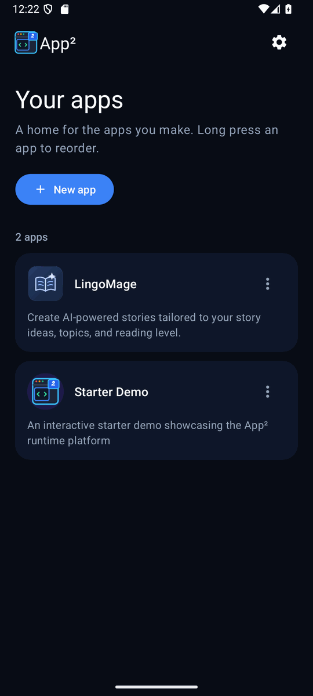
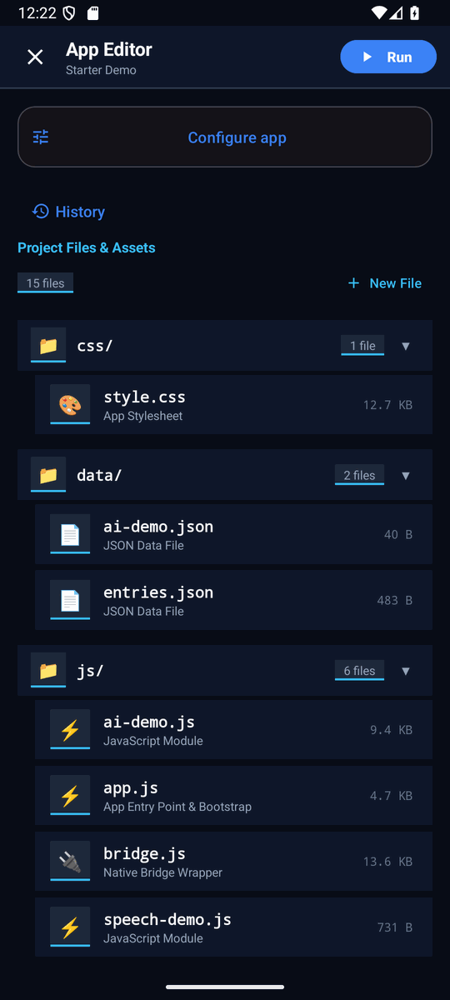
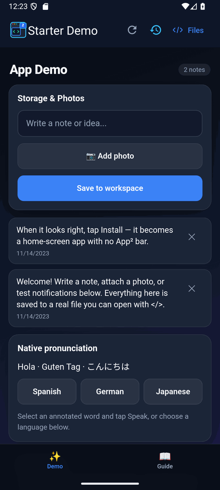
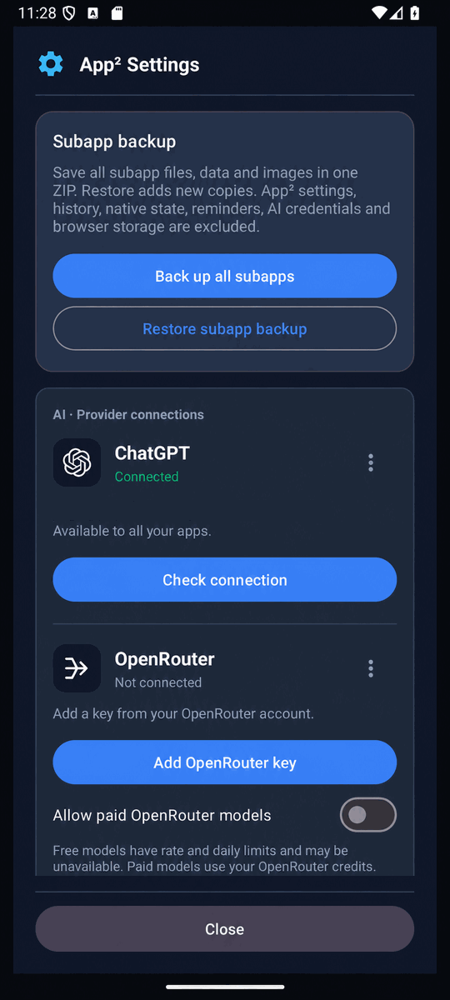

# App²

**Run web apps on your Android phone.** Import an app from GitHub or a ZIP file, launch it from your home screen, and edit its files right on your phone. Apps can use Android features like notifications and text-to-speech, and even AI through your own account.

<table>
  <tr>
    <td align="center" width="25%"></td>
    <td align="center" width="25%"></td>
    <td align="center" width="25%"></td>
    <td align="center" width="25%"></td>
  </tr>
  <tr>
    <td align="center"><strong>Library</strong></td>
    <td align="center"><strong>Editor</strong></td>
    <td align="center"><strong>Running app</strong></td>
    <td align="center"><strong>Settings</strong></td>
  </tr>
</table>

## Get started

1. Open App² and tap **New app**. Import a ZIP file, paste a public GitHub repository or folder URL, or start from the included **Starter Demo**.
2. Tap an app to run it, or choose **Edit** to change its files.
3. Choose **Install** to put the app on your home screen.

App² runs on **Android 8.0 or newer**.

## What you can do

| | |
| :--- | :--- |
| 📥 **Import** | Add apps (called *subapps*) from ZIP files or public GitHub repositories. |
| 🔄 **Update** | Pull new versions from GitHub. Your data is kept. |
| ✏️ **Edit** | Browse files, with code highlighting and search. Change each app’s name and icon. |
| 🏠 **Launch** | Each app gets its own home-screen shortcut and screen. |
| 💾 **Save files** | Each app has its own private folder for notes, settings, photos and other data. |
| 🔔 **Use Android** | Notifications, scheduled reminders, photo selection and text-to-speech. |
| ✨ **Use AI** | Connect ChatGPT, OpenRouter or any OpenAI-compatible endpoint once in **Settings → AI**. Every app can use it; your credentials never enter an app’s files. |
| 📦 **Back up & share** | Snapshots, ZIP export and Android sharing for single apps, plus one ZIP for all of them. |

## Example apps

Paste a repository URL into App² to import it.

- **[LingoMage](https://github.com/javiercmh/lingomage)** — learn languages with AI stories that match your interests and reading level.
- **[Working Hours](https://github.com/javiercmh/working-hours)** — track shifts, breaks and overtime, with end-of-day reminders.
- **[Starter Demo](app/src/main/assets/starter_template/)** — included in App². Shows storage, photos, notifications, speech and AI, with a guide to building your own app.

Example repositories have their own licences.

## Updating apps

In the library, open an app’s menu and choose **Update app** to review a new version from its GitHub repository. Updates replace the app’s code and keep your data. Importing a ZIP from the library always creates a new app. Details: [update and deployment guide](docs/SUBAPP_UPDATES.md).

## Backing up

**Back up:** In the library, open **Settings → Subapp backup → Back up all subapps** and pick where to save the ZIP. App² saves every app’s code, data, images and logs, then checks the archive before reporting success. Finish or cancel any running AI requests first, and keep a copy off the phone.

**Restore:** **Restore subapp backup** adds the apps as new copies. Existing apps are not touched. Reinstall home-screen shortcuts if needed.

<details>
<summary>What the backup does not include, and size limits</summary>

Only app folders are saved. Excluded: App² settings, native key-value state, reminders, history, update links, AI credentials, and browser storage (cookies, localStorage, IndexedDB). Store app data in `data/` so it is backed up.

Limits: 2 GB in total, 512 MB per file, fewer than 100,000 files. If there is not enough temporary storage, the backup fails with an error. This format is separate from single-app ZIP export.
</details>

## Try App² Dev

App² Dev installs next to App² with its own data and AI connections. Download its APK from a [Dev prerelease](https://github.com/javiercmh/appapp/releases) when one is available. See [Dev distribution and signing](docs/DEV_DISTRIBUTION.md).

## For developers

### Building subapps

Subapps are plain HTML, CSS and JavaScript, with a bridge to Android features. Store app data as JSON or other files under `data/` so it can be inspected, exported and restored.

- [Packaging and bridge reference](app/src/main/assets/starter_template/PACKAGING.md)
- [AI integration guide](docs/AI.md)
- [Text-to-speech guide](docs/TEXT_TO_SPEECH.md)
- [Starter Demo source](app/src/main/assets/starter_template/)

**Preview in a browser:**

```sh
python3 app/src/main/assets/starter_template/dev_server.py --mock-ai
```

Then open [localhost:8888](http://localhost:8888). Needs Python 3.9+ and nothing else. Leave out `--mock-ai` to turn AI off, or add a port number to change the port. Mock AI is offline and uses no credentials. The server writes real files to the served folder, so test on a copy. Android permissions and exact alarms still need a device.

### Building App²

The Android host uses Kotlin, Material components and WebView. Build with JDK 17 or 21:

```sh
./gradlew :app:assembleDebug :app:testDebugUnitTest
```

Other checks:

```sh
python3 -B -m unittest discover -s tests -p 'test_demo_dev_server.py'
node --test tests/*.test.mjs
```

CI runs JVM tests, lint, debug assembly and device-test compilation on JDK 21. Native interaction checks need an emulator.

- [Architecture](docs/ARCHITECTURE.md)
- [Development guidelines](AGENTS.md)
- [Pending device checks](docs/DEVICE_CHECKS.md)

## License

[MIT](LICENSE), covering everything in this repository (including the Starter Demo) unless a file says otherwise. Bundled libraries and third-party marks are listed in [THIRD_PARTY_NOTICES.md](THIRD_PARTY_NOTICES.md).

You can do whatever you want with App². One personal request: please don’t put ads, non-consensual trackers or other invasive code in your apps.

<sub>Screenshots: App² 1.7.0 on an Android 16 emulator, October 2026. Account details in the Settings screenshot were redacted.</sub>
