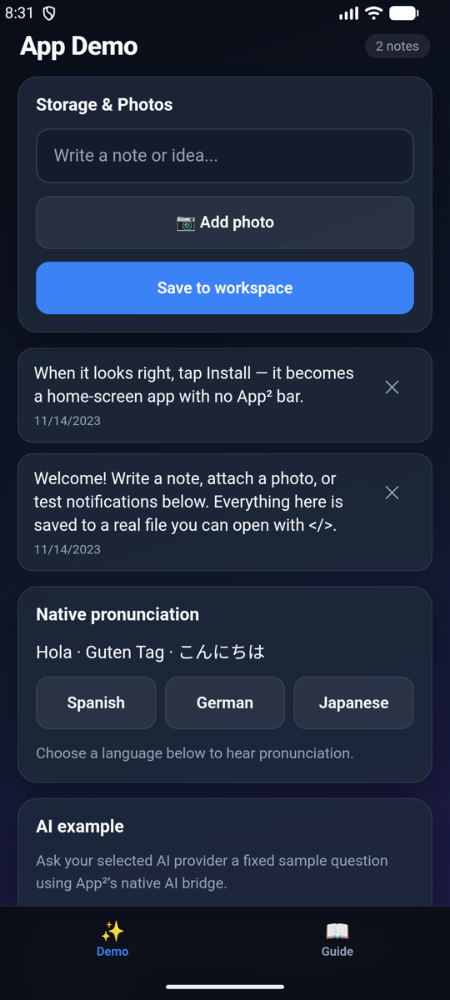
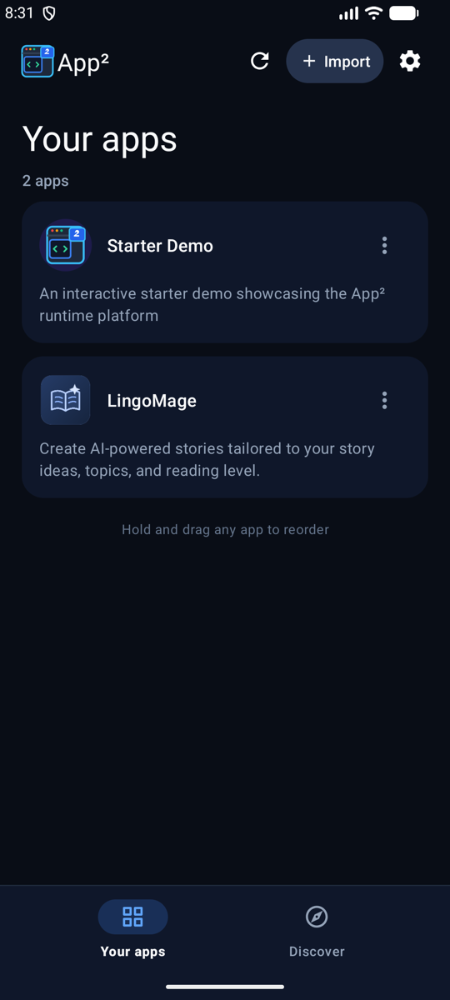
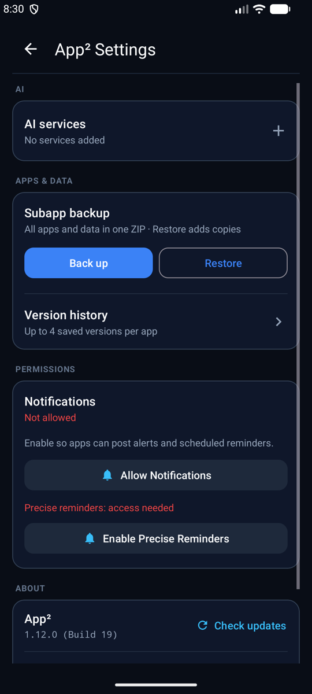

# App²

**Run web apps on your Android phone.** Pick an app from the curated Discover list or import one from GitHub or a ZIP file, launch it from your home screen, and back it up on your phone. Apps can use Android features like notifications and text-to-speech, and even AI through your own account.

<p align="center">
  
  
  
</p>
<p align="center"><sub><b>Your app</b> · <b>Library</b> · <b>Settings</b></sub></p>

## Download

Get the latest APK from [Releases](https://github.com/javiercmh/appapp/releases/latest) and open it on your phone. App² runs on **Android 8.0 or newer**.

## Get started

1. Open App². **Discover** lists curated apps: tap **Get** to install one.
2. To add something else, go to **Your apps** and tap **+**. Import a ZIP file, paste a public GitHub repository or folder link, or start from the **Starter Demo** template.
3. Tap an app to run it. Its menu has **Add to home screen**, **Configure app**, **Backup & Restore**, **Permissions**, **Update app** and **Delete**.

## What you can do

| | |
| :--- | :--- |
| 🧭 **Discover** | Browse and install curated apps, with their category, author, licence and the features they use. |
| 📥 **Import** | Add any app (called a *subapp*) from a ZIP file or a public GitHub repository. |
| 🔄 **Update** | Pull new versions from GitHub after reviewing them. Your data is kept. |
| ⚙️ **Configure** | Change an app’s name, description and icon. |
| 🗂️ **Backup & Restore** | Save or restore a version of an app, export it to your phone, or share it as a ZIP. |
| 🏠 **Launch** | Each app gets its own home-screen shortcut and screen. |
| 💾 **Save files** | Each app has its own private folder for notes, settings, photos and other data. |
| 🔔 **Use Android** | Notifications, scheduled reminders, photo and file selection, sharing, Save as and text-to-speech. |
| ✨ **Use AI** | Connect ChatGPT, OpenRouter or any OpenAI-compatible endpoint once in **Settings → AI**. Every app can use it; your credentials never enter an app’s files. |
| 🔒 **Permissions** | Apps start offline, without AI or notifications. You allow each one per app, and can revoke it in the app menu → **Permissions**. |

## Apps in Discover

- **[LingoMage](https://github.com/javiercmh/lingomage)**: learn languages with AI stories that match your interests and reading level.
- **[Working Hours](https://github.com/javiercmh/working-hours)**: track shifts, breaks and overtime, with end-of-day reminders.
- **[Starter Demo](app/src/main/assets/starter_template/)**: included in App². Shows storage, photos, notifications, speech and AI, with a guide to building your own app.

Discover ships inside App² and does not go online by itself. Tap **Refresh catalog** in Discover to download the latest list. Each app has its own licence.

## Updates and backups

- **Check for updates:** **Settings → About App² → Check for updates** checks App² and linked subapps. It shows your installed App² version and the latest release, with a GitHub link only when newer. App² Dev checks Dev releases.
- **Review subapp updates:** choose **Review updates** to review each newer version before installing, with **Skip** and **Stop reviewing** options. Updates are marked by a dot on the app’s menu and a highlighted **Update available** action. Checks run only when requested; same-version file changes do not count as a new version.
- **Update an app:** open its menu in **Your apps** and choose **Update app**, or tap **Update** on its Discover page. The code is replaced and your data is kept.
- **Restore an earlier version:** app menu → **Backup & Restore → Versions**. App² saves a version before and after every update, and you can save one yourself at any time.
- **Back up everything:** **Settings → Subapp backup** saves all your apps, with their data, in one ZIP. Restoring adds them as new copies. App² settings, reminders and AI credentials are not included.

## Try App² Dev

App² Dev installs next to App² with its own data, so you can try new features early. Get it from a [Dev prerelease](https://github.com/javiercmh/appapp/releases).

## Make your own app

Apps are plain HTML, CSS and JavaScript. Start from the [Starter Demo](app/src/main/assets/starter_template/): in App², tap **+ → Start from template**, or copy that folder into a new repository.

**For an agent building or editing a subapp:** read the [subapp author guide](app/src/main/assets/starter_template/AGENTS.md),
then the relevant section of the [runtime contract](app/src/main/assets/starter_template/PACKAGING.md).
The repository-root `AGENTS.md` is for Android host development.

For file workflows, [open a phone file](app/src/main/assets/starter_template/PACKAGING.md#choosing-a-file-from-the-phone),
[save an export](app/src/main/assets/starter_template/PACKAGING.md#save-as), or
[share with another app](app/src/main/assets/starter_template/PACKAGING.md#sharing).
Records and settings belong in [workspace data files](app/src/main/assets/starter_template/PACKAGING.md#storage-and-persistence).

To preview an app in your browser (Python 3.9+), run this from the app’s folder (or point it at the starter):

```sh
python3 app/src/main/assets/starter_template/dev_server.py --mock-ai
```

Then open [localhost:8888](http://localhost:8888).

### Put it on your phone

1. Push the app to a **public** GitHub repository, with `index.html` and `manifest.json` at its root.
2. In App², tap **+ → Import from GitHub** and paste the repository link.
3. To get updates from GitHub, add an `app2Update` block to `manifest.json` ([publisher contract](docs/SUBAPP_UPDATES.md#publisher-contract)). Without it, the app still runs, but cannot be updated in place.

## Contribute

To get your app listed in Discover or to improve App², see [CONTRIBUTING.md](CONTRIBUTING.md).

## Build App²

Needs JDK 17 or 21:

```sh
./gradlew :app:assembleDebug
```

Run the unit tests with:

```sh
./gradlew :runtime:testDebugUnitTest :app:testDebugUnitTest
```

Developer documentation is indexed in [docs/README.md](docs/README.md).

## License

[MIT](LICENSE). Third-party notices are in [THIRD_PARTY_NOTICES.md](THIRD_PARTY_NOTICES.md).

You can do whatever you want with App². One personal request: please don’t put ads, non-consensual trackers or other invasive code in your apps.
